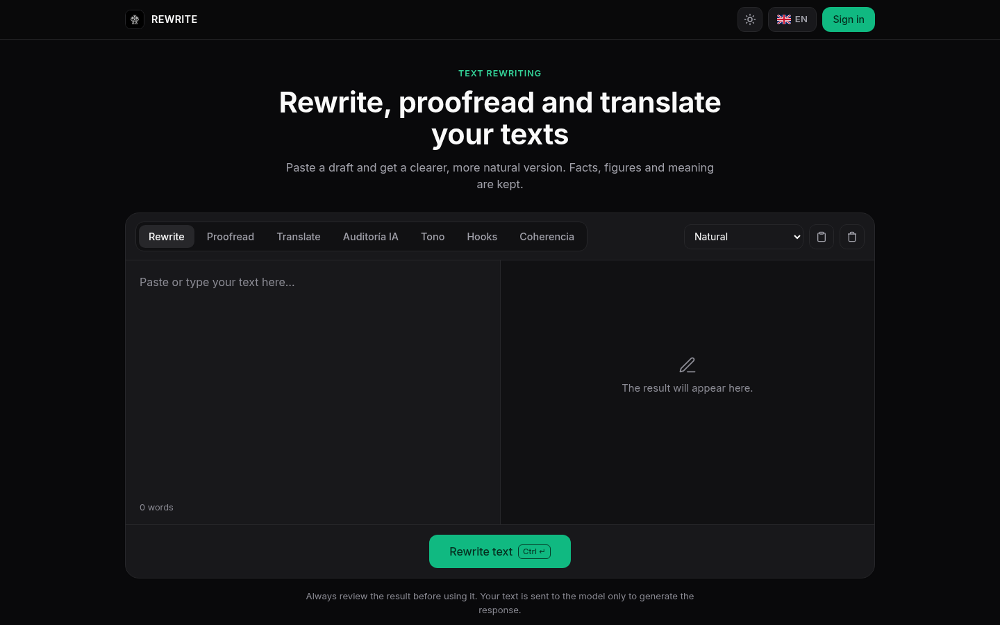
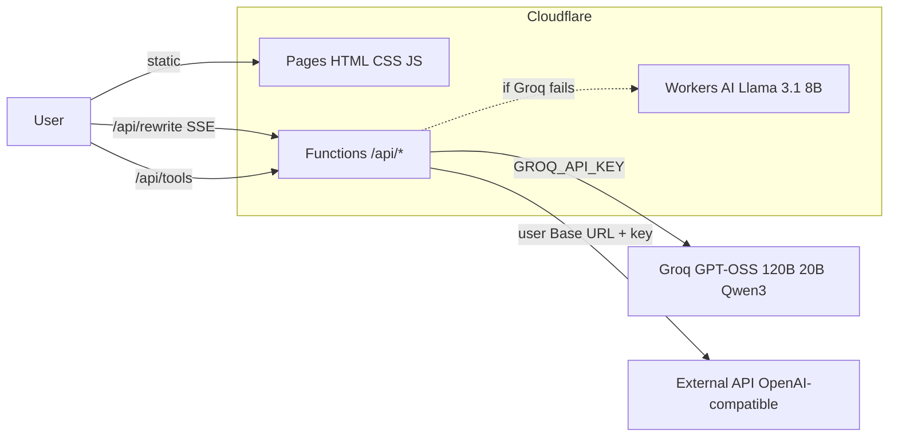

# REWRITE

<p align="center">
  <strong>以 AI 改寫、校對與翻譯文字的編輯器。保留資料、連結與 Markdown 格式。</strong><br/>
  <em>AI text editor to rewrite, proofread and translate, with streaming output (UI in 8 languages).</em>
</p>

<p align="center">
  <a href="LICENSE">MIT 授權</a>
</p>

---

## 畫面

| 桌面 | 行動裝置 |
|:-:|:-:|
|  |  |

## 功能

- **改寫:** 四種風格(自然、學術、淺白與摘要)。保留數字、名稱、連結與 Markdown。若結果太短(少於原文詞數的 85%),會用更嚴格的指示重新生成一次。
- **校對:** 拼字、文法與風格。300 字以內的文字使用小型快速模型(Groq 上的 GPT-OSS 20B)。
- **翻譯:** 西班牙文、英文、正體中文、加泰隆尼亞文、法文、德文,義大利文與葡萄牙文。
- **額外工具:** 語氣、標題鉤子、連貫性與文字 AI 稽核(使用 Groq;失敗時改用 Workers AI 備援)。
- **串流輸出:** 結果會在生成過程中即時顯示(SSE)。
- **風格變化:** 在瀏覽器中比較原文與結果的統計面板(長度、句數與變化度)。
- **多語介面(8 種語言):** 西班牙文、英文、正體中文、加泰隆尼亞文、法文、德文、義大利文與葡萄牙文,附自製 SVG 旗幟。會記住你選擇的語言。
- **簡單登入:** 由伺服器端環境變數設定的使用者名稱與密碼(見下方「部署」)。未設定時,應用程式可公開使用,不需要登入。
- **設計:** 自架的 Outfit 字型、zinc 與薄荷綠配色,依系統切換淺色或深色。

使用前請務必檢查結果。本工具並非用來掩蓋作者身分,也不是為了規避學術規範。

## 技術棧

| 層級 | 技術 |
|---|---|
| 前端 | HTML、CSS 與 JavaScript,無框架、無建置流程(`public/`) |
| 託管 | **Cloudflare Pages**(靜態檔案 + `_headers` 標頭) |
| API | **Cloudflare Pages Functions**(`functions/`),僅在 `/api/*`(`_routes.json`) |
| AI | **Groq**(主要):GPT-OSS 120B,以 GPT-OSS 20B 與 Qwen3 為備援(短文字校對用 GPT-OSS 20B)。**Workers AI**(Llama 3.1 8B)僅作為最後備援 |
| 登入 | 以 `APP_SECRET` 或 `APP_PASSWORD` 簽署的 HMAC-SHA256 JWT,存於瀏覽器並以 Bearer 標頭送出 |

## 架構



| 路由 | 用途 |
|---|---|
| `POST /api/rewrite` | 改寫、校對或翻譯。帶 `stream: true` 時以 SSE 回應 |
| `POST /api/humanize` | `/api/rewrite` 的別名 |
| `POST /api/tools` | 語氣、標題鉤子、連貫性與稽核(Groq) |
| `POST /api/analyze` | 不需 AI 的文字統計 |
| `GET /api/auth/login` | 回傳是否需要登入,以及(若已設定)使用者名稱 |
| `POST /api/auth/login` | 以使用者名稱與密碼換取 JWT |
| `GET /api/admin/summary` | 內部管理面板狀態(需登入) |

## 安全性與用量

- **儲存庫中不含機密。** 簽署金鑰(若需要)來自環境變數 `APP_SECRET` 或 `APP_PASSWORD`,不會寫入程式碼。
- **受保護的 AI 端點:** 只接受來自允許來源的瀏覽器請求(見下方)、文字上限 12,000 字元,且每個 IP 每 10 分鐘最多 30 次請求。不使用 KV 或 D1,因此防護不會產生額外計費操作。
- **輸出上限:** 依輸入文字長度按比例限制 Token 數。
- **登入為選用:** 只有同時設定 `APP_USERNAME` 與 `APP_PASSWORD` 時才會強制登入;否則 `/api/rewrite` 與 `/api/tools` 為公開。
- **標頭:** CSP、HSTS(含 preload)、`X-Frame-Options: DENY`、`nosniff`、Referrer-Policy 與 Permissions-Policy。
- **隱私:** 文字只會傳送給模型以產生回應;伺服器不保留任何紀錄。

## 外部 API(選用)

介面內建設定面板(齒輪圖示),可連接任何相容於 OpenAI 的服務:

- **Base URL**(例如 `https://api.openai.com/v1`)、**API Key** 與 **Model** 直接在瀏覽器輸入。
- 設定只儲存在瀏覽器的 `localStorage`,不會寫入儲存庫。
- 處理文字時,前端會把這些值送到 `/api/rewrite` 或 `/api/tools`;Function 會驗證 URL 為公開 HTTPS 後,才向該供應商發出請求。金鑰永遠不會寫入日誌。
- 若外部供應商失敗,且伺服器已設定備援(Groq 或 Workers AI),就會改用備援。
- 你也可在翻譯目標中選擇正體中文。

## 本機開發

需求:**Node.js >= 20** 與 `npx wrangler login`(Workers AI 需要帳號)。

若你沒有 Cloudflare 帳號,`wrangler pages dev` 會因為 Workers AI 的遠端 binding 而無法啟動。本機開發請使用 `wrangler.dev.toml`(內容與 `wrangler.toml` 相同,但沒有 `[ai]` 區塊):把它複製到根目錄成為 `wrangler.toml` 後再執行 `npm run dev`;介面上可設定的外部 API 不需要 Workers AI 也能運作。

```bash
git clone https://github.com/detutag/rewrite-ai.git && cd rewrite-ai
npm run dev
npm test
```

| 指令 | 用途 |
|---|---|
| `npm run dev` | 以 Wrangler 在本機啟動 Pages + Functions |
| `npm test` | 執行測試(`tests/*.test.mjs`、`tests/*.test.js`) |
| `npm run deploy` | `wrangler pages deploy public --project-name=rewrite-ai` |

## 部署

### 使用 Cloudflare 控制台(建議)

1. 登入 Cloudflare 控制台,前往 **Workers & Pages** → **Create** → **Pages** → **Connect to Git**。
2. 選擇你的儲存庫(例如 `ATM-Software-Labs/rewrite-ai`)與分支(通常是 `main`)。
3. 在 **Build settings** 設定:
   - Framework preset: **None**
   - Build command:**留空**
   - Build output directory:`public`
4. 在 **Settings → Environment variables**(Production 與 Preview 各設定一次)加入下方變數與 Secret。
5. 按 **Save and Deploy**。之後每次 push 到 `main` 會部署正式環境,其他分支會產生預覽。
6. 前往 **Custom domains** 綁定你的網域(例如 `rewrite.example.com`)。
7. 在 **Settings → Functions → KV namespace bindings** 加入 `BOT_MEMORY`(選用,保留給其他網站共用)。
8. 若要使用 Workers AI 作最後備援,在 **Settings → Functions → Workers AI bindings** 加入名為 `AI` 的 binding(需先在帳號啟用 Workers AI)。

> 提示:本專案沒有建置步驟,`public/` 即為靜態輸出;`functions/` 會由 Pages 自動部署為 Functions。

### 使用命令列

```bash
npx wrangler pages deploy public --project-name=rewrite-ai
```

## 環境變數與綁定

| 名稱 | 類型 | 必填 | 預設值 | 用途 |
|---|---|---|---|---|
| `GROQ_API_KEY` | Secret | 建議 | 無 | Groq 金鑰,作為改寫、校對、翻譯與工具的主要供應商。未設定時直接使用備援 |
| `DEFAULT_MODEL` | 變數 | 否 | `@cf/meta/llama-3.1-8b-instruct-fp8` | Workers AI 備援使用的模型 |
| `APP_USERNAME` | 變數 | 否 | 無 | 登入使用者名稱。與 `APP_PASSWORD` 同時設定時才會啟用登入 |
| `APP_PASSWORD` | Secret | 否 | 無 | 登入密碼。同時也作為未設定 `APP_SECRET` 時的 JWT 簽署金鑰 |
| `APP_SECRET` | Secret | 否 | `APP_PASSWORD` | 專用的 JWT 簽署金鑰(建議與密碼分開設定) |
| `ENVIRONMENT` | 變數 | 否 | `production` | 環境名稱,供記錄與除錯使用 |
| `ALLOWED_ORIGINS` | 變數 | 否 | 無 | 以逗號分隔的額外允許來源,支援 `https://example.com` 與 `*.example.com` |
| `AI` | Workers AI binding | 否 | 無 | 最後備援用的 Workers AI binding |
| `BOT_MEMORY` | KV binding | 否 | 無 | 保留(與其他網站共用) |

允許來源(不需設定即接受):`*.dogbro.store`、`*.pages.dev`、`*.230603.xyz`、`*.dogbro.link`,以及本機開發的 `localhost` / `127.0.0.1`。

## 專案結構

```
public/              index.html, 404.html, _headers, _routes.json, css/, js/ (app, i18n, flags), img/
functions/api/       rewrite.js, humanize.js, tools.js, analyze.js, auth/, admin/
functions/lib/       guard.js (origin, size, rate), auth.js (JWT), customApi.js (external API)
tests/               node --test 測試
docs/                banner 與截圖
```

## 授權

[MIT](LICENSE) © 2026 detutag。Outfit 字型採用 SIL OFL 1.1 授權。

<p align="center"><sub>© 2026 detutag · <a href="https://github.com/detutag/rewrite">GitHub</a></sub></p>
